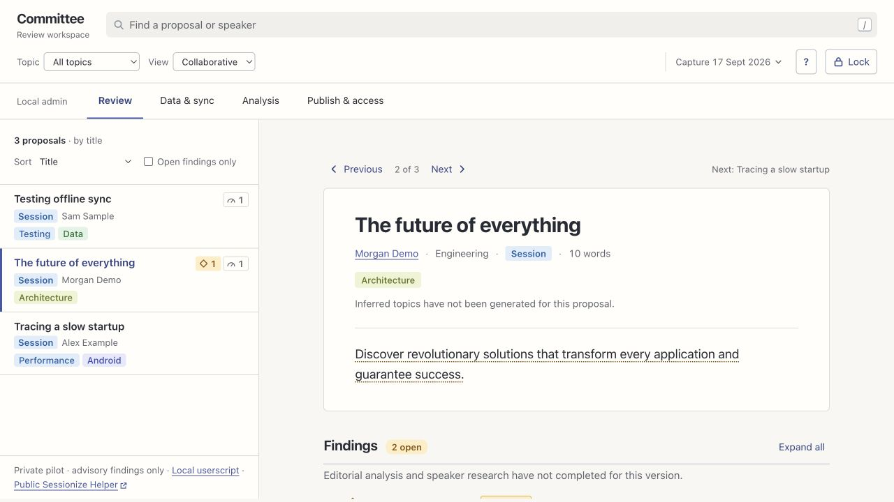

# Committee

Committee helps conference organisers review talk proposals. It imports Sessionize submissions and gathers evidence. It suggests topics and findings for people to review. People cast votes and make acceptance decisions outside Committee.

Committee is a **pilot**. Automated tests cover the local admin and reader. Release checks still need a full-event live API import and userscript testing over deployed HTTPS. The [release checklist](docs/release-readiness.md) records these limits.



## Try it with fictional data

Install Node.js 26 or later and Python 3.9 or later.

```sh
npm ci
npm run demo
```

Open `http://127.0.0.1:43129`. Read the token from the file whose path appears in the terminal, then paste it into the page.

Each demo run creates a temporary directory. The demo uses fictional records and makes no paid provider calls. It leaves your real workspace closed. Press Ctrl-C to stop it.

## Run your workspace

```sh
REVIEW_HELPER_DATA=/absolute/path/outside/the/repository npm start
```

Open the address in the terminal. The server creates a local access token and prints its file path. Keep the token private.

In **Data & sync**, connect a Sessionize JSON API endpoint. Check its coverage and save the connection. Choose **Sync now** to import submissions.

## How it fits together

```text
Sessionize API → local admin + SQLite → approved bundle → Worker + private R2
                         ↑                                   ↓
                research and detectors              reviewer site + userscript
```

The admin stores source data, credentials, research and draft findings. An administrator must request each analysis run. Publication sends selected, reviewed data to the hosted reader.

Reviewers use invitation codes to access the reader without accessing the admin machine. The event owner must allow you to host identifiable submissions.

- [User guide](docs/user-guide.md): import, review, analysis and reviewer setup
- [Sessionize sync](docs/sessionize-sync.md): scope, scheduling and limitations
- [Analysis](docs/analysis.md): providers, evidence and approval rules
- [Cloudflare hosting](docs/hosting.md): deployment, invitations and rollback
- [Operations](docs/operations.md): backups and private-data handling
- [Architecture](docs/architecture.md): implementation boundaries
- [Contributing](CONTRIBUTING.md): checks and documentation conventions

## Development

```sh
npm ci
npm run check
```

The check runs ESLint, TypeScript checking, backend and Worker tests, frontend tests, Python collector tests and the reader asset build. Tests use fictional records without provider keys. Continuous integration (CI) runs the same command on Linux.

The repository excludes conference datasets. Screenshots use fictional records from `scripts/demo.ts`. The source uses the [Apache 2.0 licence](LICENSE).
