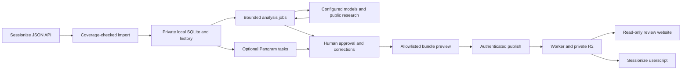

# Committee architecture

The admin machine is authoritative. The hosted copy is a read-only projection for reviewers. Neither component makes acceptance decisions or writes votes to Sessionize.

## Admin runtime

Node 26 provides the HTTP service and SQLite storage. Python 3.9+ provides bounded HTTPS transport and the legacy organiser collector. The service binds loopback, authenticates with a local capability token, validates Host/Origin, and prevents concurrent services from using the same private directory.

Current snapshots point to immutable submission versions. Imports are transactional; incomplete or failed snapshots do not replace the current event. Historical versions remain. Findings attach to content versions, and dismissals use stable finding signatures. Edits create new versions and invalidate old findings. Analysis topics are stored separately and merge with explicit tags only after approval.

The supported Sessionize API is preferred. Its secret URL stays local. Coverage checks include IDs, joins, expected count, required field definitions, scope attestations and comparison with existing IDs. The API's status filters are not machine-provable from its response. An accepted-only endpoint is not a complete CfP source. The cookie collector is an explicit fallback, not the onboarding default.

Analysis jobs freeze their configuration, bound submission count/calls/output tokens, and preserve progress. They propose topics and evidence-linked editorial/claim/speaker findings. A verifier can review the draft independently. Exact abstract spans are enforced; model-supplied source references must resolve to captured evidence. Search snippets remain leads; source-page fetches require operator-allowed hosts, public pinned addresses, size limits and no redirects. Output stays tentative until a person approves it. Speaker findings also require confirmed identity.

Pangram is a separate asynchronous queue. It sends abstract text only, persists task IDs, avoids automatic resubmission after ambiguous failures, and reuses normalized-text results. Detector fractions do not determine quality or acceptance.

## Publication boundary

`makeBundle` explicitly constructs the reader schema. It includes IDs, titles, speaker names, topics, format/track, withdrawal status, fingerprints and eligible finding summaries/source links. Full abstracts are opt-in; approved finding quotations can still contain abstract excerpts. Raw custom fields, biographies, private notes, comments, credentials and draft model findings are excluded. Strict-blind publication additionally excludes reviewer/outcome-derived findings.

A preview is saved privately with a content revision. Publishing checks that current content and approvals still match that preview. The Worker validates schema and hash, stores the immutable object, then updates the event pointer. A deliberate rollback can restore a previously published local revision. The UI is not an automatic publishing agent.

The Worker serves four source assets and authenticated R2 data. It has no Sessionize credentials, model keys or admin database. The publisher token can upload and manage invitations. Reviewer tokens have explicit event scopes and read-only routes; R2 stores their hashes. Revocation denies future requests but cannot revoke copies already downloaded. The deployment's event bundle defines the available profile; client-side display choices are not authorisation.

## Frontend and userscript

`GET /api/runtime` selects local admin or hosted reader mode. Admin controls handle source setup, sync, bounded analysis, approvals, publication preview and reviewer invitations. Reader mode consumes bundles, filters locally and has no mutation controls.

The userscript connects through a pasted invitation code in its Tampermonkey menu. No code editing or local admin token is required. It mounts compact evidence/topic/track/type badges into evaluation cards and organiser list cells, uses immediate styled tooltips, deduplicates mounts, fetches single-flight, and suppresses stale evaluation findings when title/abstract fingerprints change. Optional speaker context is off by default. The public Sessionize Helper remains independent.

## Implemented versus pending

Implemented and synthetically tested: versioned ingestion, API coverage checks, manual/periodic sync, analysis/verifier jobs, human approval, detector task persistence, bundle projection, read-only Worker/R2 delivery, invitations/revocation, frontend onboarding and userscript mounting.

Live checks: official Sessionize demo normalization, public source-page retrieval, local Wrangler/workerd/R2 publish/read/revoke, reader UI, synthetic Sessionize userscript UI. No real paid-provider acceptance or cloud deployment has been performed.

Pending: a dedicated full-scope real event API endpoint; deployed Tampermonkey acceptance; comprehensive identity/reuse research; validated semantic alternatives; votes/comments import through a supported API; historical labelling/benchmarking; Winston; discounted detector bulk mode; automated retention/erasure; optional background-service packaging. The classifier remains optional and should follow a properly adjudicated benchmark.

The original multi-model-reviewed proposal is retained in the private planning workspace. This document describes executable behavior, rather than treating that proposal as a completed release.

## Workspace navigation

The local admin has four persistent destinations: Review, Data & sync, Analysis,
and Publish & access. Administration is a page, not a modal. Sync history and
fallback authentication are collapsed disclosures. Navigation preserves the
selected proposal and active queue. The reader runtime exposes Review and
published-copy information only; it never exposes admin navigation.

The development reader preview runs separately on port 43201. Its assets must be
refreshed from `web/` when the UI changes; its approved bundle is a snapshot and
is not automatically republished by an admin UI refresh.

Data & sync uses a named event selector populated from imports, API sources and
sync configurations. It defaults to the review event when selected. Connection
method, latest run, schedule and history are scoped to this selection. A stored
login is described as available, not proof of currently valid authentication.
Connect another event opens setup with organiser-URL parsing and API instructions;
existing-event setup prefills identity. Coverage checking does not import data;
saving the checked connection returns to Sync now. Missing credentials and an
active sync disable the sync action. Source validation errors persist through
rerenders, and optional custom-field requirements stay behind a disclosure.
