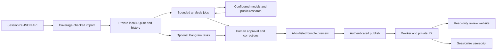

# Committee architecture

The admin machine owns the source data and review state. The hosted reader receives selected, read-only data. Both runtimes leave acceptance decisions and Sessionize votes to people.

## The admin stores private versions

Node 26 runs the HTTP service and SQLite storage. Python 3.9 or later runs the limited HTTPS transport and legacy organiser collector. The service binds loopback and requires a local capability token. It validates Host and Origin headers. A lock prevents concurrent services from sharing a private directory.

Current snapshots point to immutable submission versions. Transactional imports preserve the current event if a snapshot fails or remains incomplete. Historical versions remain available.

Findings refer to content versions. Dismissals use stable finding signatures. Edits create versions and invalidate earlier findings. Committee stores inferred topics separately. It merges them with explicit tags only after approval.

Use the supported Sessionize API for normal imports. Its secret URL stays local. Coverage checks examine IDs, joins, expected counts, required field definitions and explicit scope confirmations. They also compare existing IDs.

The response cannot prove the API's status filter settings. An accepted-only endpoint cannot supply a complete call for proposals (CfP) import. Operators can explicitly choose the cookie collector as a fallback.

## Analysis produces drafts for review

Analysis jobs freeze their configuration and preserve progress. They limit submission counts and calls. HTTP jobs also limit output tokens. Jobs suggest topics and editorial, claim and speaker findings with evidence links. An optional verifier independently reviews each draft.

The validator requires exact abstract spans. Model source references must resolve to supplied evidence. Search snippets identify possible sources. Page fetches require operator-allowed hosts, pinned public addresses and size limits. The fetcher refuses redirects.

Model output stays tentative until a person approves it. Speaker findings also need confirmed identity.

Pangram runs through a separate asynchronous queue. It receives abstract text only. Committee saves task IDs, avoids automatic resubmission after ambiguous failures and reuses results for matching normalised text. Detector fractions determine neither quality nor acceptance.

## Publication selects fields explicitly

`makeBundle` constructs the reader schema explicitly. Bundles include IDs, titles, speaker names, topics, format/track, withdrawal status, fingerprints and eligible finding summaries and source links.

Full abstracts require opt-in. Approved finding quotations can still contain abstract excerpts. Bundles exclude raw custom fields, biographies, private notes, comments, credentials and draft model findings. Strict-blind publication also excludes findings derived from reviewer input or outcomes.

Committee saves each preview privately with its content revision. Publication checks that current content and approvals still match the preview. The Worker validates the schema and hash. It stores the immutable object before updating the event pointer.

An administrator can deliberately restore a previously published local revision. The interface never publishes automatically.

The Worker serves four source assets and authenticated R2 data. It has no Sessionize credentials, model keys or admin database. The publisher token permits uploads and invitation management.

Reviewer tokens permit only read routes for explicitly selected events. R2 stores token hashes. Revocation blocks future requests but leaves downloaded copies unchanged. The deployed event bundle determines the available profile. Client display choices cannot restrict access.

## The frontend separates admin and reader controls

`GET /api/runtime` selects admin or hosted reader mode. Admin controls manage sources, sync, limited analysis runs, approvals, publication previews and invitations. Reader mode loads bundles and filters them locally. It exposes no mutation controls.

Reviewers connect the userscript by pasting an invitation code into its Tampermonkey menu. They need no code edits or local admin token. The script adds compact evidence, topic, track and type badges to evaluation cards and organiser list cells.

Tooltips appear immediately with styling. The script avoids duplicate mounts and shares concurrent fetches. Changed title or abstract fingerprints suppress stale evaluation findings. Optional speaker context starts disabled. The public Sessionize Helper runs independently.

## Navigation preserves review state

The local admin has four persistent destinations: **Review**, **Data & sync**, **Analysis**, and **Publish & access**. Administration uses a page. Sync history and fallback authentication use collapsed disclosures.

Navigation preserves the selected proposal and active queue. Reader mode exposes only **Review** and published-copy information. It hides all admin navigation.

The development reader preview runs separately on port 43201. Refresh its assets from `web/` after interface changes. Its approved bundle remains a snapshot. Refreshing the admin interface never republishes that bundle.

**Data & sync** lists named events from imports, API sources and sync configurations. It defaults to the selected review event. Connection method, last run, schedule and history all follow that selection.

A stored login means credentials are available; their validity remains unchecked. **Connect another event** opens setup with organiser-URL parsing and API instructions. Existing-event setup fills in its identity.

Coverage checking fetches data without importing it. Saving a checked connection returns to **Sync now**. Missing credentials or an active sync disable that action. Validation errors survive rerenders. Optional custom-field requirements stay in a disclosure.

## Implementation and verification limits

Synthetic tests cover versioned imports, API coverage checks, manual and periodic sync, analysis and verifier jobs, human approval and detector task persistence. They also cover bundle selection, Worker/R2 read delivery, invitations, revocation, frontend setup and userscript mounting.

Live checks covered official Sessionize demo normalisation and public source retrieval. Local checks covered Wrangler/workerd/R2 publication, reads and revocation, the reader interface and fictional Sessionize userscript pages.

Real paid-provider acceptance and cloud deployment remain unverified. Further work includes:

- Import a dedicated full-scope real event API endpoint.
- Test deployed Tampermonkey integration.
- Research identities and talk reuse more fully, and validate semantic alternatives.
- Import votes and comments through a supported API.
- Label and benchmark historical data.
- Add Winston and discounted detector bulk mode.
- Add automated retention and erasure, and optional background-service packaging.

The optional classifier needs a properly adjudicated benchmark first. The private planning workspace retains the original proposal and its multi-model review. That proposal includes work beyond the executable behaviour described here.
