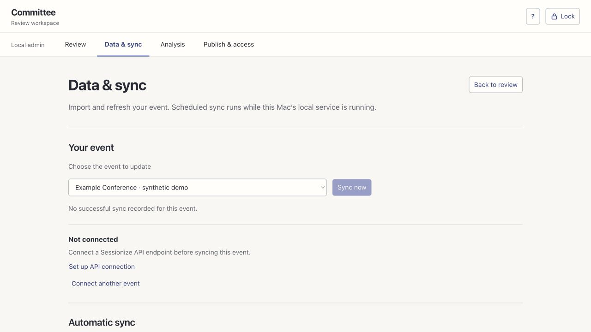

# User guide

Committee has a local administrator workspace and a hosted, read-only reviewer site. Use the administrator workspace to import data, check findings and publish revisions. Use the reviewer site or Sessionize userscript to read the approved result.

## Start locally

Install Node.js 26+ and Python 3.9+, run `npm ci`, then start with `REVIEW_HELPER_DATA` pointing outside the checkout. Open the address printed by the server and read the access token from the printed file. The browser remembers it until you choose **Lock**. Keep the admin on loopback; do not expose its port to the internet.

For a first look without event data, run `npm run demo`. Its records are fictional and its database is temporary.

## Import an event

1. Open **Data & sync → Connect another event**.
2. Paste the Sessionize organiser event URL, or its numeric event ID. For `/app/organizer/sessions/12345`, the ID is `12345`. Give the event a recognisable name.
3. In Sessionize's **API / Embed**, prepare a dedicated JSON endpoint that includes all submissions and unscheduled sessions, with no category filter. Copy its `/view/All` URL. Creating such an endpoint makes selected data available to holders of the URL; keep it private.
4. Paste that URL into Committee and choose **Check coverage**. Compare the result with the organiser's submission count. Enable descriptions, biographies and required custom fields in Sessionize if they are missing.
5. Confirm the endpoint scope only after checking its actual settings. Save the connection, then choose **Sync now**.

A saved connection describes where to fetch data. **Sync now** imports it. The two actions are separate so you can inspect coverage before replacing an event snapshot. An accepted-only feed is not a complete CfP import.

After the first successful sync, **Automatic sync** can schedule updates. The machine must be awake and the local service running. Sync does not automatically run paid analysis or publish changes. See [sync details](sessionize-sync.md).

## Read and correct findings

Choose a proposal in **Review**. Search by title or speaker, or filter by topic. Open a speaker's name for available profile information. A missing finding does not establish that a proposal has been checked or is good.

Findings distinguish measurements, proposed model findings and approved findings. Open **Evidence** to inspect the reason, quotation, sources and provenance. **Show in abstract** locates the cited passage. Add a note or dismiss a finding when it is misleading. Detector signals remain separate from editorial quality: generated-text fractions are not authorship probabilities.

Use `j`/`k` to move between proposals, `/` to search, `e` to expand findings, `c` to compare an available related proposal, and `?` for the shortcut reference. Typing in a field does not trigger these shortcuts.

## Run analysis

Configure provider credentials locally using the [analysis guide](analysis.md). In **Analysis**, choose the event and a bounded batch. Research and detector checks are explicit actions and can incur provider charges. Review evidence before approving findings or inferred topics. Speaker findings also require identity confirmation before publication.

Edits to a title or abstract create a new content version. Findings attached to an older version must not be treated as current. Imported detector results can be reused only under the recorded matching rules.

## Give reviewers access

Follow the [hosting guide](hosting.md) to deploy the reader. In **Publish & access**, configure its origin and publisher credential, select an event and profile, then preview the bundle. Inspect the fields and findings before publishing that revision.

Create an invitation scoped to the intended events and share its connection code privately. A reviewer can paste the code into the hosted site. For Sessionize integration, install the userscript from that site, open Sessionize, choose **Connect Committee…** in Tampermonkey, and paste the same code. The public Sessionize Helper is a separate script.

Revoke invitations when access is no longer needed. Revocation blocks later requests; it cannot erase copies already downloaded. Invitations currently have no automatic expiry.

## Troubleshooting

| Symptom | What to check |
| --- | --- |
| Local page refuses to connect | Keep the terminal running; use its printed port. |
| Unlock fails | Read the token file for this data directory, not another workspace. |
| Coverage is below the organiser count | Check accepted-only, scheduled-only and category filters in Sessionize. Do not confirm completeness just to enable saving. |
| Scheduled sync does not run | The machine must be awake and the service running. Inspect the selected event's sync history. |
| A paid check failed | Inspect its status before retrying: the provider may already have charged for an ambiguous request. |
| Reader shows old data | Sync and publication are separate. Preview and publish a new revision. |
| No userscript badges | Check the invitation's event scope, host permission and whether findings were approved and published. |

Back up the private data directory before upgrades. See [operations](operations.md) for database-safe backup and retention limits.
